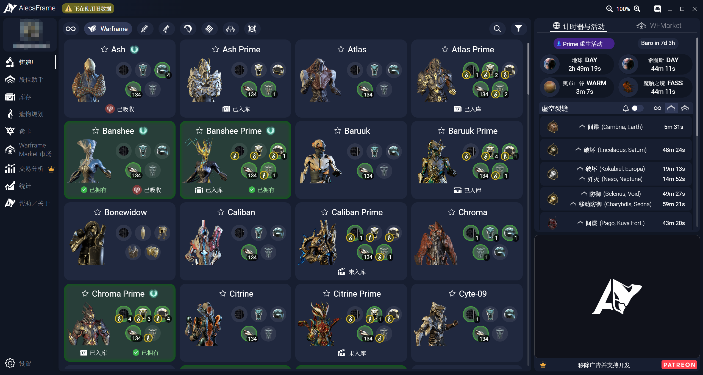
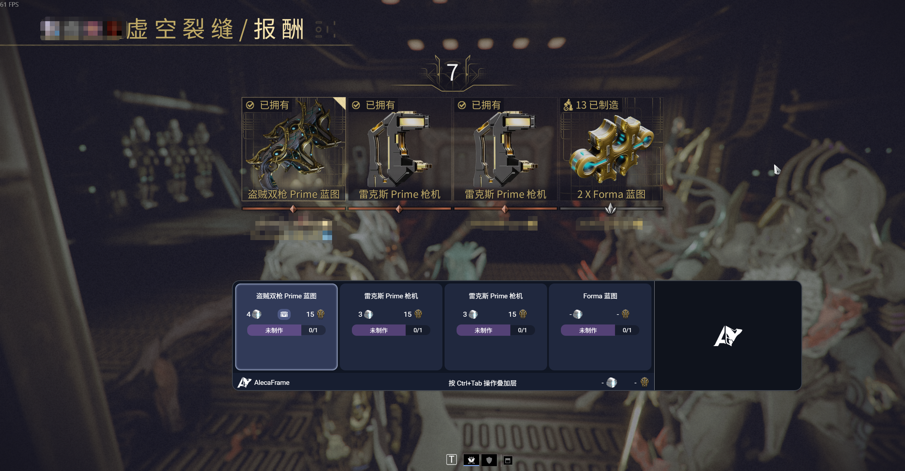

# AlecaFrame 简体中文补丁

给通过 Overwolf 官方商店安装的 AlecaFrame 加载简体中文界面，并支持在中文 Warframe 中识别遗物奖励。

- 加载简体中文界面。
- 支持在**中文与英文** Warframe 中识别遗物奖励。
- 鉴于作者还是萌新，当前汉化仍然不完全（武器名称、黑话、紫卡），欢迎各位大佬贡献。

## 使用方法

1. 先通过 Overwolf 官方商店安装 AlecaFrame，并正常打开、等待游戏数据加载完成。
2. 解压本包，**双击 `启动中文版.cmd`**。之后每次都用它启动中文版。
3. 要恢复官方文件，双击 `还原官方版.cmd`。

启动器会寻找本机官方安装，首次运行时自动构建中文遗物识别服务，并在修改前备份相关文件。请把 ZIP 完整解压后运行，**不要直接在压缩包预览窗口里双击**。
**当前支持 Overwolf `0.311.0.6`、AlecaFrame `2.6.94`。**

## 效果展示

## 可能遇到的问题

- 提示找不到 AlecaFrame：确认已从 Overwolf 官方商店安装并打开过一次。
- 提示版本不兼容：等待本项目适配该版本，不要强行修改扩展清单。
- 游戏内遗物奖励识别失败：确保 Warframe 使用简体中文，并检查 Windows 是否有简体中文文字识别组件。日志位于 `%LOCALAPPDATA%\AlecaFrame-ZH-Patch\relic-service.log` 和 `%LOCALAPPDATA%\Overwolf\Log\Apps\AlecaFrame\RelicOverlay.html.log`。

## 源码与许可

`Build.ps1` 使用 Windows 的 .NET Framework 编译器，并引用用户已经安装的 AlecaFrame 中的 `Newtonsoft.Json.dll`。编译产物只写到本机 `build/`。中文遗物识别读取 AlecaFrame 本机的截图和物品词库，结果只写到 `%LOCALAPPDATA%\AlecaFrame-ZH-Patch`。英文等官方已支持的游戏语言仍由原识别流程处理。

## 参考仓库
界面翻译与部分实现参考项目 [AlecaFrame-ZH-](https://github.com/191086215333/AlecaFrame-ZH-)
