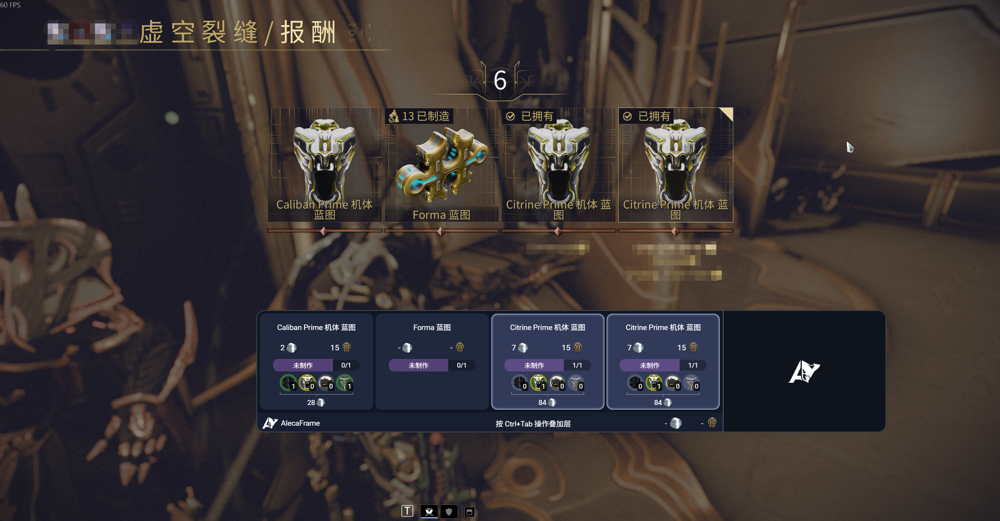
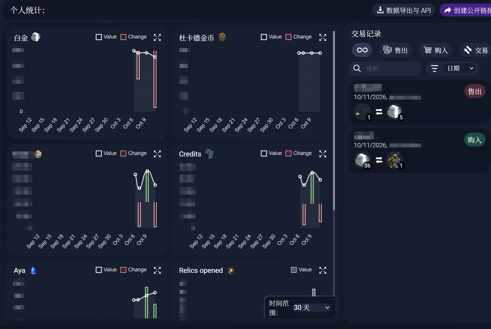

# AlecaFrame 简体中文补丁

给通过 Overwolf 官方商店安装的 AlecaFrame 加载简体中文界面

- 支持**简体中文界面**
- 支持在**中文游戏**中识别中文遗物奖励显示铸造部件、持有与所需数量、制作状态和套装价格
- 支持**中文游戏**的**交易历史解析**与**交易物品名称**汉化
- 支持在**中文游戏的遗物选择界面**自动显示遗物推荐
- 鉴于作者还是萌新，当前汉化仍然不完全（黑话、随机紫卡名称），欢迎各位大佬贡献

## 使用方法

1. 先通过 Overwolf 官方商店安装 [AlecaFrame](https://alecaframe.com/)，并正常打开、等待游戏数据加载完成。
2. 解压本包，**双击 `启动中文版.cmd`**。之后每次都用它启动中文版。
3. 要恢复官方文件，双击 `还原官方版.cmd`。

启动器会寻找本机官方安装，首次运行时自动构建中文遗物识别服务，并在修改前备份相关文件。请把 ZIP 完整解压后运行，**不要直接在压缩包预览窗口里双击**。
**当前支持 Overwolf `0.311.0.6`、AlecaFrame `2.6.95`。**

## 效果展示

## 可能遇到的问题

- 提示找不到 AlecaFrame：确认已从 Overwolf 官方商店安装并打开过一次。
- 提示版本不兼容：等待本项目适配该版本，不要强行修改扩展清单。
- 游戏内遗物奖励识别失败：确保 Warframe 使用简体中文，并检查 Windows 是否有简体中文文字识别组件。日志位于 `%LOCALAPPDATA%\AlecaFrame-ZH-Patch\relic-service.log` 和 `%LOCALAPPDATA%\Overwolf\Log\Apps\AlecaFrame\RelicOverlay.html.log`。
- 中文交易未出现：确认 AlecaFrame 设置中已启用统计，通过本项目的启动器启动，再完成一笔交易并刷新“统计 → 交易历史”。确认交易弹窗本身不会记账，必须收到游戏的交易成功提示。解析日志在 `%LOCALAPPDATA%\AlecaFrame-ZH-Patch\trade-patch.log`，官方提交结果在 `%LOCALAPPDATA%\Overwolf\Log\Apps\AlecaFrame\BackGround.html.log`。

## 仍未实现的功能
- 遗物规划器功能汉化
- 紫卡功能汉化
- 紫卡重掷骰评分功能

## 参考仓库
- 界面翻译与部分实现参考项目 [AlecaFrame-ZH-](https://github.com/191086215333/AlecaFrame-ZH-)
- 词库参考项目 [wfm-docs](https://github.com/42bytes-team/wfm-docs)
